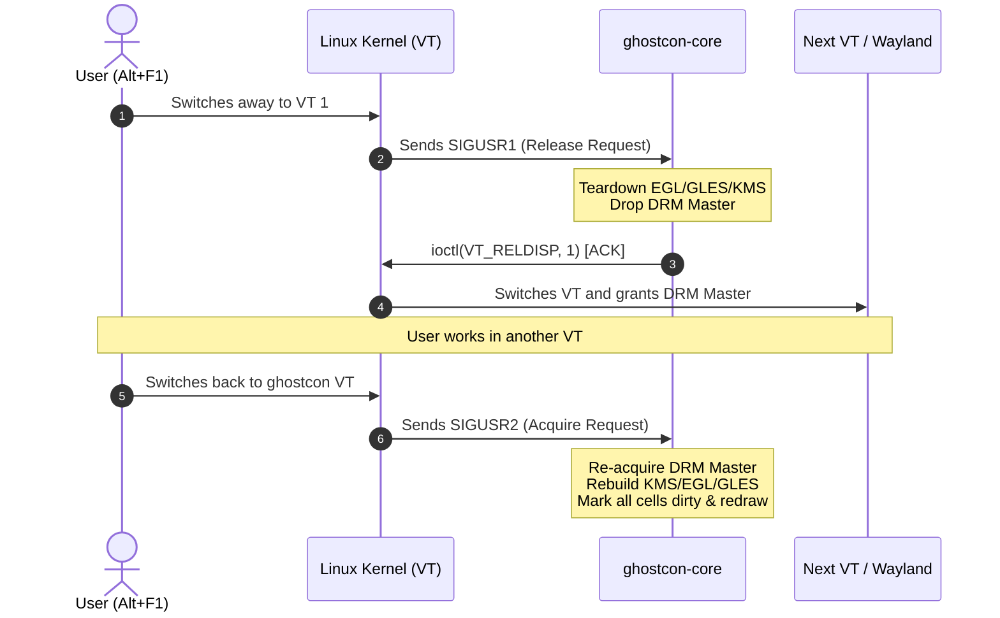
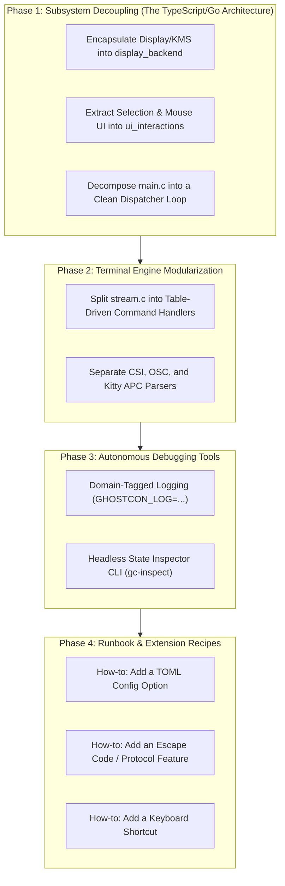

# ghostcon: Architecture Analysis, OS Internals & Refactor Plan

> [!IMPORTANT]
> **Maintainer Profile Calibrated:**
> - **Background:** Strong experience with high-level typed languages (TypeScript, Go, Java, C#, Swift) and comfortable with C pointers/memory.
> - **Identified Challenge:** Unfamiliar with opaque Linux OS internals (DRM/KMS modesetting, VT ioctl state machines, POSIX signal handshakes, Linux PTY subsystems).
> - **Objective:** Full autonomy to maintain, extend (protocols/features/UI), and debug `ghostcon` without relying on an LLM.

---

## 1. Executive Summary & Codebase Health

`ghostcon` is a **bare-metal userspace virtual terminal system** replacing kernel `fbcon` and `agetty` directly on Linux VTs (`/dev/ttyN`). It features:
- **Terminal Core:** Ported from Ghostty's Zig engine to C11 with `libghostty-vt` parsers.
- **Direct GPU Acceleration:** Linux DRM/KMS atomic modesetting, GBM buffer allocation, EGL, and OpenGL ES 2.0.
- **Hang-Proof Supervision:** Multiprocess canary watchdog architecture that guarantees the physical console never freezes even if the renderer crashes.

### Verified Test Status
The test suite compiles and runs cleanly under native Meson/Ninja:
- **18 / 18 tests passing** (`test_term`, `test_conformance`, `test_render`, `test_input`, `test_supervisor`, `test_undead_head`, etc.).

---

## 2. Demystifying the Unfamiliar: The 4 Linux OS Internals

Because you understand pointers and memory, the C language itself is not your barrier. The friction comes from **Linux kernel subsystem interfaces** that are currently tangled directly into application logic. Here is the mental model for each:

### 1. DRM / KMS (Direct Rendering Manager / Kernel Mode Setting)
In high-level languages, a windowing toolkit (Electron, GLFW, Qt) handles displays. On a raw TTY, **you are the display server**.
- **Connector:** The physical port (e.g. HDMI-A-1, eDP-1). Probed via `drmModeGetConnector()`.
- **CRTC (Cathode Ray Tube Controller):** The hardware display engine scanning pixels out of memory onto a display at a specific resolution/refresh rate.
- **Planes:** Display layers blended by hardware:
  - *Primary Plane:* Holds the main terminal framebuffer rendered via EGL/GLES.
  - *Cursor Plane:* A separate, tiny hardware sprite layer for the mouse cursor (`ghostcon_kms_move_cursor`). Its position updates instantly via atomic ioctls without redrawing the terminal.
- **DRM Master:** The kernel allows only **one process at a time** to control the display. When switching VTs, `ghostcon-core` must drop DRM Master (`drmDropMaster`) so the other VT (or Wayland/Xorg) can take over.

### 2. VT Subsystem & ioctl Handshake
A Linux Virtual Terminal (`/dev/tty1` to `/dev/tty63`) is controlled via `ioctl(fd, ...)`:
- `VT_PROCESS`: Puts the VT into cooperative mode. Instead of the kernel forcibly killing graphics on switch, the kernel sends signals:
  - `SIGUSR1`: *"The user pressed Alt+F1/F2 to switch away. Please release the screen."*
  - `SIGUSR2`: *"The user switched back. You own the screen again."*
- `VT_RELDISP`: The ACK ioctl. `ghostcon` calls `ioctl(vt_fd, VT_RELDISP, 1)` to tell the kernel: *"I have torn down my GPU context and dropped DRM Master. You may now switch VTs."*



### 3. PTY (Pseudo-Terminal) Subsystem
A pseudo-terminal provides a bidirectional pipe that behaves like a real serial hardware teletype:
- **Master side (`ptm`):** Held by `pty-ttyN` / `ghost-ptyserv`. `ghostcon-core` talks to this over a UNIX domain socket (`ghostcon_transport_t`).
- **Slave side (`pts`):** `/dev/pts/X` given to `/bin/login` or the shell. The kernel's TTY line discipline handles echoing, signals (`Ctrl+C` $\to$ `SIGINT`), and window size updates (`ioctl(TIOCSWINSZ)`).
- **Process Isolation:** Because the shell lives inside `pty-ttyN` and `ghostcon-core` is purely a display client, `ghostcon-core` can crash, restart, or reload shaders without terminating the user's shell session or losing scrollback.

### 4. POSIX Signals & Event Multiplexing (`poll`)
Instead of threads with locks or async runtimes, `ghostcon-core` runs a single-threaded reactor using `poll()`:
- `poll()` waits simultaneously on:
  - VT signal fd (`signalfd` or pipe from signal handler).
  - PTY UNIX socket (bytes from the shell).
  - Libinput fd (mouse movements, keyboard presses).
  - Canary watchdog fd (heartbeat from supervisor).
  - Inotify fd (`ghostcon.toml` hot reload).

---

## 3. The Problem: Where the Current Codebase Traps You

In [`src/core/main.c`](file:///home/bashh/Coding/ghostcon/src/core/main.c) (1,659 lines), the `app_t` struct and `main()` loop entangle these 4 OS concepts directly with UI and terminal logic:

```c
// In src/core/main.c today:
if (input_idx >= 0 && (fds[input_idx].revents & POLLIN)) {
    // 1. Dispatch keyboard and mouse
    ghostcon_input_dispatch(...);
    // 2. Hardware cursor hover test
    if (pointer.moved && app.display_acquired) {
        // Direct DRM cursor plane ioctl!
        ghostcon_kms_move_cursor(&app.kms, pointer.x, pointer.y);
        // Direct cell hyperlink inspection!
        if (cell_is_hyperlink) ghostcon_kms_set_cursor_state(...);
    }
    // 3. Selection start/drag/release
    ghostcon_selection_update(...);
    // 4. Font zoom calculation & atlas rebuild
    if (zoom_delta != 0) apply_font_size(...);
}
```

Whenever you want to add a feature (e.g. word-by-word selection, a keybinding, or a new config option), you have to navigate between DRM modeset checks, `poll()` index arrays, and VT state transitions. That entanglement is why you currently feel reliant on an LLM to explain and avoid breaking changes.

---

## 4. The 4-Phase Refactor Plan for Complete Maintainability



---

### Phase 1: Decouple the Core Subsystems (Creating Safe Boundaries)

Treat each OS subsystem as an isolated "Adapter" with a clean interface, exactly like you would in Go or TypeScript:

#### 1.1 `src/core/display_backend.h` & `.c`
Isolates all KMS, DRM Master, EGL, and GLES lifecycle management:
```c
typedef struct ghostcon_display ghostcon_display_t;

ghostcon_display_t *ghostcon_display_create(const char *drm_node, int vt_num);
bool ghostcon_display_acquire(ghostcon_display_t *disp, uint32_t *width, uint32_t *height);
void ghostcon_display_release(ghostcon_display_t *disp);
void ghostcon_display_move_cursor(ghostcon_display_t *disp, int x, int y, ghostcon_cursor_state_t state);
bool ghostcon_display_present_frame(ghostcon_display_t *disp, ghostcon_machine_t *machine, ghostcon_screen_t *screen);
void ghostcon_display_destroy(ghostcon_display_t *disp);
```
*Why this saves you:* When editing rendering, text styles, or UI, you never touch DRM Master or ioctls. The display backend handles all the low-level graphics plumbing behind 5 clear methods.

#### 1.2 `src/core/ui_interactions.h` & `.c`
Extracts mouse hover, selection logic, drag, and click-copy out of `main.c`:
```c
void ghostcon_ui_handle_pointer_motion(ghostcon_screen_t *screen, ghostcon_display_t *disp,
                                       int x, int y, int cell_w, int cell_h);
void ghostcon_ui_handle_mouse_button(ghostcon_screen_t *screen, ghostcon_selection_t *sel,
                                     const ghostcon_input_pointer_t *pointer, int cell_w, int cell_h);
```
Pure logic with zero KMS/DRM dependencies. Easy to test and modify without risking display freezes.

#### 1.3 `src/core/main.c` Becomes a High-Level Reactor
The main event loop shrinks from 1,659 lines to ~250 lines of high-level event routing:
```c
while (app.running) {
    poll(fds, nfds, timeout);
    if (vt_event)        handle_vt_lifecycle(&app);
    if (pty_event)       handle_pty_data(&app);
    if (input_event)     handle_input(&app);
    if (config_event)    handle_config_reload(&app);
    if (app.need_render) handle_presentation(&app);
}
```

---

### Phase 2: Modularize the Terminal Parser (`stream.c`)

[`src/term/stream.c`](file:///home/bashh/Coding/ghostcon/src/term/stream.c) currently has cognitive complexity **575** because all escape sequences are parsed in one nested switch statement.

#### 2.1 Table-Driven CSI & OSC Dispatch
Split `stream.c` into:
- `src/term/stream_csi.c`: Table of CSI handlers (`handle_csi_cursor_move`, `handle_csi_erase`, `handle_csi_sgr`).
- `src/term/stream_osc.c`: Handlers for OSC 8 (hyperlinks), OSC 52 (clipboard), OSC 4/10/11 (colors), OSC 0/2 (titles).
- `src/term/stream_apc.c`: Kitty graphics protocol chunk routing.

Adding a new escape sequence will simply mean adding one function and registering it in a dispatch table:
```c
static const csi_handler_entry_t csi_table[] = {
    { 'H', 0, handle_cursor_position },
    { 'J', 0, handle_erase_display },
    { 'm', 0, handle_sgr },
    // Adding a new sequence is just 1 new line here!
};
```

---

### Phase 3: Autonomous Debugging Tools (Zero-LLM Independence)

When maintaining code without an LLM, your developer tools must answer *"What just happened?"* instantly.

#### 3.1 Domain-Specific Structured Logging
Replace raw `fprintf` with categorized log channels enabled via environment variables:
```bash
# Debug only input and selection:
GHOSTCON_LOG=input,selection ghostcon-core 4

# Debug only VT switching and DRM master transitions:
GHOSTCON_LOG=vt,drm ghostcon-core 4

# Debug escape sequence parser:
GHOSTCON_LOG=stream ghostcon-core 4
```
Implementation is a clean 50-line macro utility in `include/ghostcon/core/log.h`.

#### 3.2 Headless Inspector CLI (`tools/gc-inspect`)
A command-line tool that takes a recorded PTY byte stream and renders the internal terminal state to the console:
```bash
# Inspect what ghostcon's internal grid actually looks like:
tools/gc-inspect --dump-cells session.raw
# Outputs exact cell-by-cell breakdown: [char='A', style_id=0, tag=BG_COLOR_RGB, wide=0]
```
You can diagnose rendering issues without switching to a real VT or attaching GDB.

---

### Phase 4: Maintenance Runbook & Extension Recipes

We will document concrete recipes in `docs/`:

#### Recipe A: Adding a new TOML config option
1. Add the field to `struct ghostcon_config` in [`include/ghostcon/config/config.h`](file:///home/bashh/Coding/ghostcon/include/ghostcon/config/config.h).
2. Add default value and parsing logic in [`src/config/config.c`](file:///home/bashh/Coding/ghostcon/src/config/config.c) using `toml_table_string()` / `toml_table_bool()`.
3. Add a unit test in [`tests/test_config.c`](file:///home/bashh/Coding/ghostcon/tests/test_config.c).

#### Recipe B: Adding a new Keybinding Shortcut
1. Define the action enum in [`include/ghostcon/core/input.h`](file:///home/bashh/Coding/ghostcon/include/ghostcon/core/input.h).
2. Map the shortcut string (e.g. `"ctrl+shift+c"`) to keysyms in [`src/core/input.c`](file:///home/bashh/Coding/ghostcon/src/core/input.c).
3. Connect the action handler in the event loop.

#### Recipe C: Safe VT/KMS Hardware Testing
Run tests safely without locking up your primary display:
```bash
# 1. Run all unit & integration tests headlessly:
meson test -C build-release

# 2. Run a real child program under a virtual headless DRM node:
build-release/tools/headless_probe out.ppm 1920 1080 16 500 -- htop
```

---

## 5. Next Actionable Milestone

We can proceed step-by-step. The highest-leverage first step is:
**Step 1: Extract `display_backend` and `ui_interactions` out of `src/core/main.c`.**
This will immediately cut the god-object in half, wrap all the unfamiliar DRM/KMS/VT plumbing into a safe box, and make the rest of the codebase feel like clean, idiomatic code you can maintain with total confidence.

---

## 6. Implementation Status

Phases 1–4 above are implemented, each as a reviewable commit:

| Phase | Commit content | Verification |
|---|---|---|
| 1.2 `ui_interactions` | `src/core/ui.c`, `tests/test_ui.c`, cursor-state type moved to DRM-free `cursor_image.h` | `test_ui` (unit) |
| 1.1 + 1.3 `display_backend` | `src/core/display.c`; `main.c` 1663 → 1275 lines, no DRM/EGL/GLES symbols left in it | full suite + live service restart, all VTs acquired |
| 2 parser split | `stream.c` 1930 → 636 lines (state machine only); `stream_csi.c`, `stream_osc.c`, `stream_apc.c`, `stream_internal.h` | `test_conformance`, `test_term`, `test_osc` |
| 3.1 domain logging | `include/ghostcon/core/log.h` (`GHOSTCON_LOG=...`), tagged sites in display/main/ui/stream | `test_log` |
| 3.2 headless inspector | `tools/gc_inspect.c` (`gc-inspect`), tag+payload cell dump | `test_gc_inspect` |
| 4 runbook | `docs/RUNBOOK.md` | recipes reference the real APIs above |
| VT transition test | `ghostcon_vtctl_transition()` in `core/vtctl.c` (pure), `tests/test_vtctl.c` | `test_vtctl` (unit); the ioctl/signal side still needs a real VT |
| Hotspot 1 evdev lookup | `src/core/input.c`: `evdev_key_table[KEY_MAX+1]` replaces the 164-line `ghostcon_input_evdev_to_ghostty_key` switch | `test_input` (unit) |
| Hotspot 2 parser states | `src/term/stream.c`: `ghostcon_stream_process_byte` (cx 119 / cog 575) split into 15 `stream_state_*` handlers, a `stream_handle_c1` guard, and a thin dispatch switch → cx 17 / cog 32 | full suite + ASan/UBSan + fuzzer smoke |
| Hotspot 3 sixel split | `src/term/sixel.c`: `ghostcon_sixel_decode` (cx 47 / cog 204) split into `sixel_measure`, `sixel_paint`, and `sixel_set_column` → cx 8 / cog 9; added `tests/test_sixel.c` (the decode path had no unit coverage) | `test_sixel` (unit) |

Current test count: **23/23** (`meson test -C build-release`).
Live-service deploys use `build-release` + `meson install` + restart, per
`CLAUDE.md`; that restart drops active VT sessions.
