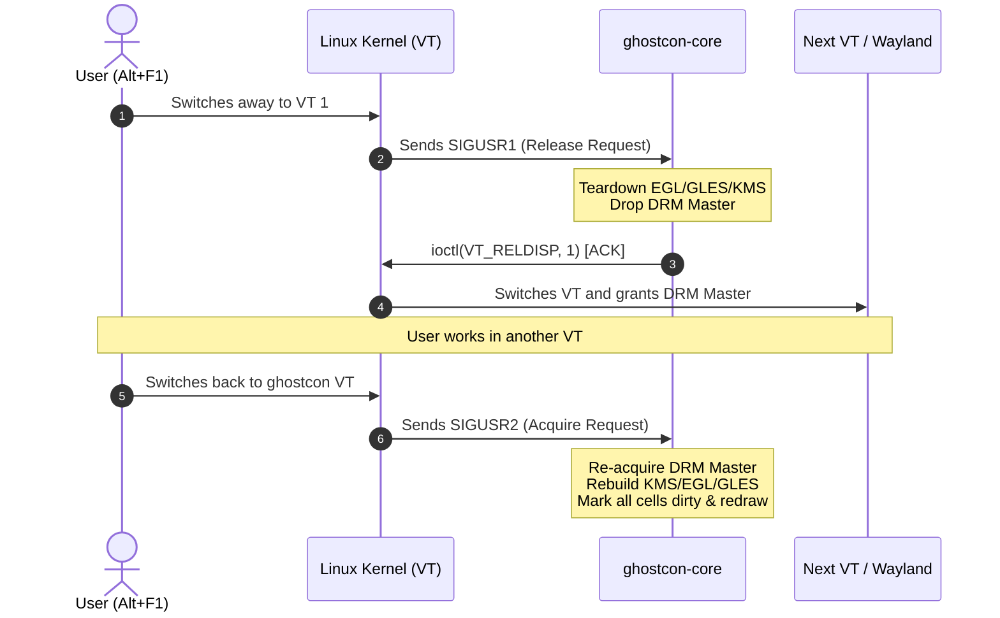
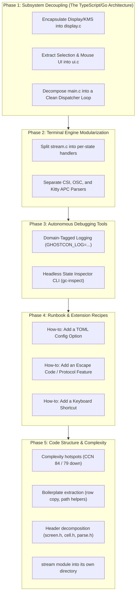

# ghostcon: Architecture Analysis, OS Internals & Refactor Plan

> [!IMPORTANT]
> **Maintainer Profile Calibrated:**
> - **Background:** Strong experience with high-level typed languages (TypeScript, Go, Java, C#, Swift) and comfortable with C pointers/memory.
> - **Identified Challenge:** Unfamiliar with opaque Linux OS internals (DRM/KMS modesetting, VT ioctl state machines, POSIX signal handshakes, Linux PTY subsystems).
> - **Objective:** Full autonomy to maintain, extend (protocols/features/UI), and debug `ghostcon` without relying on an LLM.

---

## 1. Executive Summary & Codebase Health

`ghostcon` is a **bare-metal userspace virtual terminal system** replacing kernel `fbcon` and `agetty` directly on Linux VTs (`/dev/ttyN`). It features:
- **Terminal Core:** Ported from Ghostty's Zig engine to C11 with `libghostty-vt` parsers.
- **Direct GPU Acceleration:** Linux DRM/KMS atomic modesetting, GBM buffer allocation, EGL, and OpenGL ES 2.0.
- **Hang-Proof Supervision:** Multiprocess canary watchdog architecture that guarantees the physical console never freezes even if the renderer crashes.

### Verified Test Status
The test suite compiles and runs cleanly under native Meson/Ninja:
- **23 / 23 tests passing** (`test_term`, `test_conformance`, `test_render`, `test_input`, `test_supervisor`, `test_undead_head`, etc.).

### Where the remaining work is
Phases 1-4 (§4) fixed *architecture*: module boundaries, parser decomposition, autonomous debugging tools, and the runbook. What is left is *intra-module shape* — a handful of functions too branchy to modify safely, boilerplate that makes one change need three edits, and a few headers that have outgrown their single file.

That work is scoped in **§7 (Phase 5)**, with a recommended order of work in **§7.7**.

---

## 2. Demystifying the Unfamiliar: The 4 Linux OS Internals

Because you understand pointers and memory, the C language itself is not your barrier. The friction comes from **Linux kernel subsystem interfaces** that were tangled directly into application logic. Here is the mental model for each:

### 1. DRM / KMS (Direct Rendering Manager / Kernel Mode Setting)
In high-level languages, a display toolkit (Electron, GLFW, Qt) owns the display. On a raw TTY, **you are the display server**.
- **Connector:** The physical port (e.g. HDMI-A-1, eDP-1). Probed via `drmModeGetConnector()`.
- **CRTC (Cathode Ray Tube Controller):** The hardware display engine scanning pixels out of memory onto a display at a specific resolution/refresh rate.
- **Planes:** Display layers blended by hardware:
  - *Primary Plane:* Holds the main terminal framebuffer rendered via EGL/GLES.
  - *Cursor Plane:* A separate, tiny hardware sprite layer for the mouse cursor (`ghostcon_kms_move_cursor`). Its position updates instantly via atomic ioctls without redrawing the terminal.
- **DRM Master:** The kernel allows only **one process at a time** to control the display. When switching VTs, `ghostcon-core` must drop DRM Master (`drmDropMaster`) so the other VT (or Wayland/Xorg) can take over.

### 2. VT Subsystem & ioctl Handshake
A Linux Virtual Terminal (`/dev/tty1` to `/dev/tty63`) is controlled via `ioctl(fd, ...)`:
- `VT_PROCESS`: Puts the VT into cooperative mode. Instead of the kernel forcibly killing graphics on switch, the kernel sends signals:
  - `SIGUSR1`: *"The user pressed Alt+F1/F2 to switch away. Please release the screen."*
  - `SIGUSR2`: *"The user switched back. You own the screen again."*
- `VT_RELDISP`: The ACK ioctl. `ghostcon` calls `ioctl(vt_fd, VT_RELDISP, 1)` to tell the kernel: *"I have torn down my GPU context and dropped DRM Master. You may now switch VTs."*



### 3. PTY (Pseudo-Terminal) Subsystem
A pseudo-terminal provides a bidirectional pipe that behaves like a real serial hardware teletype:
- **Master side (`ptm`):** Held by `pty-ttyN` / `ghost-ptyserv`. `ghostcon-core` talks to this over a UNIX domain socket (`ghostcon_transport_t`).
- **Slave side (`pts`):** `/dev/pts/X` given to `/bin/login` or the shell. The kernel's TTY line discipline handles echoing, signals (`Ctrl+C` $\to$ `SIGINT`), and window size updates (`ioctl(TIOCSWINSZ)`).
- **Process Isolation:** Because the shell lives inside `pty-ttyN` and `ghostcon-core` is purely a display client, `ghostcon-core` can crash, restart, or reload shaders without terminating the user's shell session or losing scrollback.

### 4. POSIX Signals & Event Multiplexing (`poll`)
Instead of threads with locks or async runtimes, `ghostcon-core` runs a single-threaded reactor using `poll()`. The actual poll set is built in `core_fill_poll()` (`src/core/main.c:1374`):
- VT self-pipe fd (`ghostcon_vtctl_signal_fd`) — the signal handler writes a byte; the reactor reads it.
- Inotify config-watch fd (`ghostcon_config_watch_open`) — `ghostcon.toml` hot reload.
- Transport fd (`ghostcon_transport_fd`) — PTY bytes from the shell.
- Transport control fd (`app->transport.ctl_fd`) — out-of-band control requests; `-1` if the control connection never came up.
- Libinput fd (`ghostcon_input_fd`) — only while this VT is active/acquired.
- Key-repeat `timerfd` (`ghostcon_input_repeat_fd`) — `-1` if `timerfd_create()` failed at `input_open()` time.

**Canary direction:** `ghostcon-core` *writes* the heartbeat (`src/core/main.c:1593`); the supervisor *polls* it and kills the renderer if the deadline passes. `GHOSTCON_CANARY_FD` carries the inherited fd into the child.

---

## 3. The Problem: Where the Codebase Trapped You (as of the start of the refactor)

> [!NOTE]
> This section describes the codebase **before** Phase 1. It is kept as the record of what motivated the refactor. The current state is tracked in §6, and the remaining problems are in §7.

In `src/core/main.c` (1,659 lines at the time), the `app_t` struct and `main()` loop entangled these 4 OS concepts directly with UI and terminal logic:

```c
// In src/core/main.c, before Phase 1:
if (input_idx >= 0 && (fds[input_idx].revents & POLLIN)) {
    // 1. Dispatch keyboard and mouse
    ghostcon_input_dispatch(...);
    // 2. Hardware cursor hover test
    if (pointer.moved && app.display_acquired) {
        // Direct DRM cursor plane ioctl!
        ghostcon_kms_move_cursor(&app.kms, pointer.x, pointer.y);
        // Direct cell hyperlink inspection!
        if (cell_is_hyperlink) ghostcon_kms_set_cursor_state(...);
    }
    // 3. Selection start/drag/release
    ghostcon_selection_update(...);
    // 4. Font zoom calculation & atlas rebuild
    if (zoom_delta != 0) apply_font_size(...);
}
```

Whenever you wanted to add a feature (word-by-word selection, a keybinding, a new config option), you had to navigate between DRM modeset checks, `poll()` index arrays, and VT state transitions. That entanglement was the reason for feeling reliant on an LLM to explain and avoid breaking changes.

Phase 1 (§4) removed exactly this: `main.c` today contains no DRM/EGL/GLES symbols, and the four concerns above live in `core/display.c` and `core/ui.c`.

---

## 4. The Refactor Plan



---

### Phase 1: Decouple the Core Subsystems (Creating Safe Boundaries)

Treat each OS subsystem as an isolated "Adapter" with a clean interface, exactly like you would in Go or TypeScript:

#### 1.1 `src/core/display.c` + `include/ghostcon/core/display.h`
Isolates all KMS, DRM Master, EGL, and GLES lifecycle management behind a small opaque API:
```c
typedef struct ghostcon_display ghostcon_display_t;

ghostcon_display_t *ghostcon_display_create(const char *drm_node, int vt_num, bool gamma_correct);
void             ghostcon_display_destroy(ghostcon_display_t *disp);
bool             ghostcon_display_acquire(ghostcon_display_t *disp, int cell_h, ghostcon_atlas_t *atlas, ...);
void             ghostcon_display_release(ghostcon_display_t *disp);
void             ghostcon_display_move_cursor(ghostcon_display_t *disp, int x, int y);
void             ghostcon_display_set_cursor_state(ghostcon_display_t *disp, ghostcon_cursor_state_t state);
bool             ghostcon_display_render_frame(ghostcon_display_t *disp, ghostcon_screen_t *screen, ...);
```
*Why this saves you:* When editing rendering, text styles, or UI, you never touch DRM Master or ioctls.

#### 1.2 `src/core/ui.c` + `include/ghostcon/core/ui.h`
Extracts mouse hover, selection logic, drag, and click-copy out of `main.c`. Pure logic with zero KMS/DRM dependencies:
```c
ghostcon_cursor_state_t ghostcon_ui_compute_cursor_state(ghostcon_screen_t *screen, ...);
bool                    ghostcon_ui_update_selection(ghostcon_screen_t *screen, ...);
int                     ghostcon_ui_compute_zoom(int current_font_size, int zoom_delta, int zoom_step, ...);
void                    ghostcon_ui_extract_command_token(const char *title, char *out, size_t out_len);
void                    ghostcon_ui_build_comm_name(int vt_num, const char *token, char *out);
```
The cursor-state type deliberately lives in the DRM-free `include/ghostcon/core/cursor_image.h`, so `ui.c` never pulls in KMS.

#### 1.3 `src/core/main.c` Becomes a High-Level Reactor
The main event loop was decomposed into `parse_env_settings`, `load_initial_settings`, `core_connect_transport`, `core_fill_poll`, and `core_dispatch_events`, leaving high-level event routing:
```c
while (app.running) {
    poll(fds, nfds, timeout);
    if (vt_event)        handle_vt_lifecycle(&app);
    if (pty_event)       handle_pty_data(&app);
    if (input_event)     handle_input(&app);
    if (config_event)    handle_config_reload(&app);
    if (app.need_render) handle_presentation(&app);
}
```

---

### Phase 2: Modularize the Terminal Parser (`stream.c`)

`src/term/stream.c` had cognitive complexity **575** because all escape sequences were parsed in one nested switch statement.

Split into:
- `src/term/stream_csi.c`: CSI final dispatch and handlers.
- `src/term/stream_osc.c`: OSC number dispatch and handlers.
- `src/term/stream_apc.c`: Kitty graphics / SOS-PM-APC and DCS (sixel) payload routing.

The dispatch ownership split is documented in `src/term/stream_internal.h`: the state machine in `stream.c` collects bytes, then hands each sequence category to exactly one module. Adding an escape sequence is one handler function plus one row in that module's dispatch table — for OSC that is `osc_dispatch_table[]` (`src/term/stream_osc.c:352`).

> [!WARNING]
> The CSI side has **not** been converted to a table yet. `csi_lookup()` (`src/term/stream_csi.c:770`) is still a nested switch and is the highest-complexity function in the tree. See §7.1.1.

---

### Phase 3: Autonomous Debugging Tools (Zero-LLM Independence)

When maintaining code without an LLM, your developer tools must answer *"What just happened?"* instantly.

#### 3.1 Domain-Specific Structured Logging
Categorized log channels enabled via environment variables:
```bash
# Debug only input and selection:
GHOSTCON_LOG=input,selection ghostcon-core 4

# Debug only VT switching and DRM master transitions:
GHOSTCON_LOG=vt,drm ghostcon-core 4

# Debug escape sequence parser:
GHOSTCON_LOG=stream ghostcon-core 4
```
Implementation is a header-only macro utility in `include/ghostcon/core/log.h`.

#### 3.2 Headless Inspector CLI (`gc-inspect`)
A command-line tool that takes a recorded PTY byte stream and renders the internal terminal state to the console:
```bash
# Cell-by-cell breakdown:
build-release/src/gc-inspect --dump-cells --cols 80 --rows 24 session.raw
# Output: [char='A', style_id=0, tag=BG_COLOR_RGB, wide=0]
```
You can diagnose rendering issues without switching to a real VT or attaching GDB.

---

### Phase 4: Maintenance Runbook & Extension Recipes

Concrete recipes live in `docs/RUNBOOK.md`:

#### Recipe A: Adding a new TOML config option
1. Add the field to `struct ghostcon_config` in `include/ghostcon/config/config.h`.
2. Add default value and parsing logic in `src/config/config.c` using `toml_table_string()` / `toml_table_bool()`.
3. Add a unit test in `tests/test_config.c`.

#### Recipe B: Adding a new Keybinding Shortcut
1. Define the action enum in `include/ghostcon/core/input.h`.
2. Map the shortcut string (e.g. `"ctrl+shift+c"`) to keysyms in `src/core/input.c`.
3. Connect the action handler in the event loop.

#### Recipe C: Safe VT/KMS Hardware Testing
Run tests safely without locking up your primary display:
```bash
# 1. Run all unit & integration tests headlessly:
meson test -C build-release

# 2. Run a real child program under a virtual headless DRM node:
build-release/src/headless_probe out.ppm 1920 1080 16 500 -- htop
```

---

## 5. Current Milestone

Phases 1-4 are complete (§6). The active milestone is **Phase 5: Code Structure & Complexity** (§7).

**Done so far:** §7.5 S1 (the stream module's own directory), §7.1.1 (the CSI
dispatch table), §7.1.2 + §7.1.3 (the Kitty graphics transmit path, with the
module's first unit test), §7.2 (the boilerplate extraction), §7.3 (the header
decomposition), §7.4 (the naming consolidation), §7.5 S2-S4 (the stream
module's private headers) and §7.1.4-§7.1.6 (the remaining hotspots) -- see §6.

**The plan's scope is now executed**, and the *enforcement* is in place
too: §7.6's complexity gate (CCN 30) runs in CI, so none of the hotspots
can grow back. Nothing in the tree is above CCN 30 now (the worst is 28),
the average is 5.9 (down from 6.5), and 40 functions are at CCN >= 15 (down
from 48).

**What is left is coverage, not structure.** The two subsystems where a
mistake is most expensive -- the render loop and the input event handling
-- now have tests of their own decisions (`test_render_quads`,
`test_input_rules`), but the paths that need real hardware (DRM master,
VT signals, a libinput device) still have no automated check, and the
renderer still has no oracle other than a human comparing it against a
real Ghostty. See the RUNBOOK's module map for what covers what.

---

## 6. Implementation Status

Phases 1-4 above are implemented, each as a reviewable commit:

| Phase | Commit content | Verification |
|---|---|---|
| 1.2 `ui` | `src/core/ui.c`, `tests/test_ui.c`, cursor-state type moved to DRM-free `cursor_image.h` | `test_ui` (unit) |
| 1.1 + 1.3 `display` | `src/core/display.c`; `main.c` 1663 -> 1275 lines at the time, no DRM/EGL/GLES symbols left in it | full suite + live service restart, all VTs acquired |
| 2 parser split | `stream.c` 1930 -> 636 lines at the time (state machine only); `stream_csi.c`, `stream_osc.c`, `stream_apc.c`, `stream_internal.h` | `test_conformance`, `test_term`, `test_osc` |
| 3.1 domain logging | `include/ghostcon/core/log.h` (`GHOSTCON_LOG=...`), tagged sites in display/main/ui/stream | `test_log` |
| 3.2 headless inspector | `tools/gc_inspect.c` (`gc-inspect`), tag+payload cell dump | `test_gc_inspect` |
| 4 runbook | `docs/RUNBOOK.md` | recipes reference the real APIs above |
| VT transition test | `ghostcon_vtctl_transition()` in `core/vtctl.c` (pure), `tests/test_vtctl.c` | `test_vtctl` (unit); the ioctl/signal side still needs a real VT |
| Hotspot 1 evdev lookup | `src/core/input.c`: `evdev_key_table[KEY_MAX+1]` replaces the 164-line `ghostcon_input_evdev_to_ghostty_key` switch | `test_input` (unit) |
| Hotspot 2 parser states | `src/term/stream.c`: `ghostcon_stream_process_byte` (cx 119 / cog 575) split into 15 `stream_state_*` handlers, a `stream_handle_c1` guard, and a thin dispatch switch -> cx 17 / cog 32 | full suite + ASan/UBSan + fuzzer smoke |
| Hotspot 3 sixel split | `src/term/sixel.c`: `ghostcon_sixel_decode` (cx 47 / cog 204) split into `sixel_measure`, `sixel_paint`, and `sixel_set_column` -> cx 8 / cog 9; added `tests/test_sixel.c` (the decode path had no unit coverage) | `test_sixel` (unit) |
| Hotspot 4 OSC dispatch | `src/term/stream_osc.c`: `osc_dispatch_manual` (cx 46 / cog 160) split into a number-keyed `osc_dispatch_table` of `osc_handle_*` functions -> cx 4 / cog 5 | `test_osc` + full suite |
| Hotspot 5 pty loop | `src/ptyserv/pty_child.c`: `main` (cx 50 / cog 134) split into a `pty_child_t` state struct plus `pty_child_setup`/`pty_child_teardown` and per-event `pty_child_handle_*` helpers -> cx 13 / cog 26 | full suite + ASan/UBSan |
| Hotspot 6 core loop | `src/core/main.c`: `main` (cog 62) split into `parse_env_settings`, `load_initial_settings`, `core_connect_transport`, `core_fill_poll`, and `core_dispatch_events` -> cx 17 / cog 23 (helpers <= 9) | full suite + ASan/UBSan |

| Phase 5 S1 | the stream module moved into `src/term/stream/`; 4 lines in `src/meson.build` | full suite + ASan/UBSan |
| Phase 5 7.1.1 | `csi_lookup()` became `csi_table[]`, searched with a binary search over a table sorted by final byte: CCN 84 -> 11, and the RUNBOOK recipe is now "add one row". Covered by the new `tests/test_csi_dispatch.c`, which asserts every intermediate variant still dispatches and that the table stays sorted | `test_csi_dispatch` (new); equivalence against the old switch checked over 4,499,456 combinations of final byte / intermediate count / intermediate values / parameter count |
| Phase 5 7.1.2 + 7.1.3 | `src/term/kitty_graphics.c`: the transmit path runs through a per-command context (`kitty_cmd_t`) that carries the ack target and the buffer and image slot the command owns, so every failure exit is one `kitty_fail(cmd, "error=...")` line instead of a re-typed five-argument `kitty_ack(...)` call. The path is split into the steps it actually has (resolve transfer / medium / format / dimensions, fetch payload, claim slot, accumulate, finalize, place). `kitty_parse_control`'s 17-arm `strcmp` chain became a table of (key, kind, length rule, field offset) rows. `handle_transmit` CCN 79 -> 12 (416 -> 33 lines); `kitty_parse_control` CCN 39 -> 6 (121 -> 72 lines) | `test_kitty_graphics` (new); equivalence against the old implementation checked over 46 single-command cases and 9 multi-command sessions, comparing the ack bytes, the image store, the placement table, the byte accounting and the reported cursor move after every command -- all identical, and clean under ASan/UBSan |
| Phase 5 kitty test | `tests/test_kitty_graphics.c` -- the module's first unit test, covering the transmission/placement/ack protocol, the medium sandbox (`/tmp` and `/dev/shm` only, the `t=t` "must be named `tty-graphics-protocol`" rule, and exactly which files get deleted), and the chunked transfer's cross-chunk placement state | 65 assertions; three deliberate regressions (dropping the `t=t` filename convention, not unlinking the shm segment, not restoring the first chunk's `z=`) each make it fail |
| Phase 5 N2-N4 | the 44 `GHOSTCON_*` C identifiers moved to `GC_*` (the generator `tools/gen_ghostty_themes.py` moved with the two names it emits); the 25 remaining `GHOSTCON_*` names are runtime strings only. The two old-style include guards became `#pragma once` like the other 35 headers. `GC_STYLE_ID_DEFAULT` deleted in favour of `GC_STYLE_DEFAULT_ID`. The `gc_` file-static tables in `cell.c` renamed, and the `GC_LOG` verdict cache hoisted from per-call-site to per-domain (with the domain list as an X-macro, so an unknown domain is a compile error) | full suite + ASan/UBSan; the rename is compiler-checked, and the diff contains no changed string literal |
| Phase 5 B1-B7 | the boilerplate extractions: `ghostcon_row_copy()` in `row.c` for the four byte-identical row shifts (B1); one `ghostcon_resolve_sibling_path()` in the new `core/paths.h` for the three copies (B2, B3); one `ghostcon_unix_listen_socket()` / `ghostcon_unix_connect_socket()` in the new `ptyserv/socket.h` for the three AF_UNIX socket sites (B4); `push_quad()` takes a `ghostcon_quad_t` instead of 19 positional floats, with `is_glyph`/`is_color_glyph` as bools again (B5); the `kitty_control_t` sentinels were already a designated-initializer list (B6, done with the kitty work); one named `ghostcon_plane_props_t` and one table-driven property resolver for the two plane structs and their twenty repeated lookups (B7) | full suite + ASan/UBSan; every one is a pure extraction |
| Phase 5 H1-H5 | `screen.c` (1755 lines, 47 public functions) split into four files with four headers (`screen_cursor.c`, `screen_edit.c`, `screen_scroll.c` + the matching headers), with the module's private helpers in `src/term/screen_internal.h` (H1); `cell.h`'s field widths named and the accessors collapsed behind `GC_CELL_GET`/`GC_CELL_SET` (H2); `parse.h`'s four conversions collapsed to two bodies (H3); the duplicate `ghostcon_screen_t` declaration moved to `screen_fwd.h`, which both `screen.h` and `selection.h` include (H4); the Kitty *keyboard* protocol renamed to `kitty_keyboard.h`/`kitty_keyboard.c` (H5) | full suite + ASan/UBSan + fuzzer smoke; all 47 screen functions still defined exactly once, every header still compiles standalone (all 40) |
| Phase 5 S2-S4 | the stream module's private header split per dispatch module (`stream_csi.h`, `stream_osc.h`, `stream_apc.h`; `stream_internal.h` is now the shared preamble) (S2); the false opacity claim in the module's header comment corrected -- the public header *does* expose the stream struct, and the term layer embeds it by value (S3); the public header now describes the 4-file layout, and the RUNBOOK's stale OSC recipe (it still said "add a `case` to `osc_dispatch_manual()`", which is now the table `osc_dispatch_table[]`) plus the module's paths in the RUNBOOK map and in `IMPLEMENTATION.md` are fixed (S4) | full suite + ASan/UBSan |

Current test count: **25/25** (`meson test -C build-release`).
Live-service deploys use `build-release` + `meson install` + restart, per
`CLAUDE.md`; that restart drops active VT sessions.

---

## 7. Phase 5: Code Structure & Complexity

### 7.0 Why this phase exists, and how it is measured

Phases 1-4 fixed architecture. Phase 5 fixes **intra-module shape**: the remaining functions too branchy to modify safely, the boilerplate that makes one logical change need three edits, and the headers that have outgrown one file.

**Metric:** CCN (cyclomatic complexity) — the number of independent decision paths through a function. Base 1, +1 per branch (`if`, `case`, `&&`, `||`, loop). A CCN-10 function can be enumerated by inspection; a CCN-84 function cannot, so it has to be reasoned about structurally instead.

**Baseline** (`lizard` over `src/`, 576 functions, 13,760 NLOC):

| | |
|---|---|
| average CCN | 6.5 |
| functions >= CCN 15 | 48 |
| functions >= CCN 30 | 18 |
| functions >= CCN 50 | **4** |
| functions <= CCN 8 | ~150 |

The long tail is healthy. The problem is 12 functions at CCN >= 28 and two above 79.

> [!NOTE]
> `lizard` is a measurement tool for this plan, not a repo dependency. Exact numbers vary slightly between tools; treat these as a relative ranking, not an absolute verdict. Re-measure with `lizard src/` after each change and compare against §7.1.

### 7.1 Complexity hotspots

Re-measured after the whole of §7 (`lizard src/`, 559 functions, 13,977
NLOC, average CCN 5.9, 40 functions at CCN >= 15 -- down from 6.5 and 48).

| Function | Location | CCN | Lines | Params |
|---|---|---:|---:|---:|
| `handle_csi_request_mode` | `src/term/stream/stream_csi.c:399` | **28** | 44 | 2 |
| `main` | `src/undead_head/main.c:242` | 27 | 228 | 2 |
| `load_cursor_state` | `src/core/display.c:45` | 26 | 91 | 7 |
| `main` | `src/supervisor/main.c:476` | 25 | 219 | 2 |
| `ghostcon_screen_put_char` | `src/term/screen_edit.c:86` | 24 | 110 | 2 |
| `ghostcon_screen_dump` | `src/term/dump.c:6` | 23 | 63 | 2 |
| `render_rounded_corner` | `src/render/box_draw.c:231` | 22 | 53 | 4 |
| `ghostcon_kms_set_cursor_image` | `src/core/kms.c:360` | 21 | 130 | 8 |
| `ghostcon_parse_keybinding` | `src/core/input.c:668` | 20 | 89 | 3 |
| `ghostcon_display_acquire` | `src/core/display.c:276` | 19 | 93 | 5 |

**Done:** `csi_lookup` (CCN 84 -> 11, §7.1.1), `handle_transmit` (CCN 79 ->
12, §7.1.2), `kitty_parse_control` (CCN 39 -> 6, §7.1.3),
`ghostcon_machine_render_dirty` (CCN 38 -> 8, §7.1.4),
`handle_pointer_event` (CCN 38 -> 6, §7.1.5),
`handle_keyboard_event` (CCN 28 -> 3, §7.1.5), `handle_csi_sgr` (CCN 34 ->
21), `sixel_measure` (CCN 31 -> 21), `stream_state_esc` (CCN 30 -> 11),
`gc_stream_osc_dispatch` (CCN 30 -> 10), `parse_color_intro` (CCN 28 -> 13),
`load_glyph_into_slot` (CCN 28 -> 2) -- §7.1.6.

Nothing in the tree is above CCN 30 any more. The three that took the place
at the top of the list were not in the original table at all: they are
process-lifecycle `main()`s, a cursor-state loader, and the CSI request-mode
handler -- all real code, none of them a parser or a render loop.

#### 7.1.1 `csi_lookup` (CCN 84) — labelled a table, but it is not one

`src/term/stream_csi.c:765` comments `/* CSI dispatch table */` above a function that is two nested switches: a 12-case switch where each case holds an if-chain, totalling **25 `if (inter_len == ...)` tests**. Every DEC-private variant adds another branch, and the branches are indistinguishable once you are 40 lines into the function.

The underlying data is a clean 3-tuple — `(final byte, intermediate length, intermediate[0])` -> handler — and it is simply not stored as one:

```c
static const struct {
    uint8_t                final;
    uint8_t                inter_len;
    uint8_t                inter0;
    gc_stream_csi_handler_t fn;
} csi_table[] = {
    { 'H', 0, 0,    handle_csi_cursor_position },
    { 'p', 1, '$',  handle_csi_request_mode },
    { 'u', 1, '>',  handle_csi_kitty_push },
    /* ... */
};
```

**Status: done.** `csi_table[]` is a sorted array of
`(final, inter_len, inter0, inter1, handler)` rows, searched with a
binary search. `csi_lookup()` went **CCN 84 -> 11** (not the ~3 the
first sketch predicted -- the binary search accounts for the difference),
111 lines -> 28, and the RUNBOOK recipe is now *"add one row to
`csi_table[]`*.

Two things the sketch did not anticipate:

- **The table has to stay sorted by final byte**, because the lookup
  binary-searches it. An out-of-order row is dispatched *wrongly* rather
  than rejected -- and a CSI sequence the table does not match is
  silently ignored, so nothing would report it. `gc_stream_csi_table_sorted()`
  exposes the invariant, and `tests/test_csi_dispatch.c` checks it.
- **The intermediate variants had no test coverage at all.** Only 5 of
  the 17 appeared anywhere in the suite, which is exactly the set that
  would misdispatch silently. `tests/test_csi_dispatch.c` now covers
  every one.

The OSC side already does this — `osc_dispatch_table[]` (`src/term/stream_osc.c:352`). CSI never got the same treatment.

#### 7.1.2 `handle_transmit` (CCN 79) — 12 parameters, 22 duplicated error exits

`src/term/kitty_graphics.c:740`, 416 lines. Every failure path is the same three lines:

```c
kitty_ack(output_fn, userdata, quiet, id, ctl->placement_id, "error=EINVAL:...");
return;
```

`kitty_ack` takes 6 arguments, so `output_fn, userdata, quiet, id, ctl->placement_id` is retyped at all **31** `kitty_ack` call sites in the file, and 22 of them are inside this one function.

Fix: a per-transfer context struct carrying the ack fields plus the decoded buffer, with a `kitty_fail(ctx, "error=...")` helper that acks and returns. Expected: CCN 79 -> ~25, and the 22 exits become one-liners.

**Status: done.** The context is `kitty_cmd_t`, and it carries more than the
ack fields: the resolved transfer parameters, the buffer the command owns,
and the image slot it claimed. `kitty_fail()` releases the latter two, so a
failing command cannot leak either — the two things that actually leak
memory in a terminal that reads images off the filesystem.

The result is **CCN 79 -> 12** (416 -> 33 lines), but not by the route the
sketch predicted: removing the 22 duplicated `kitty_ack(...)` calls removes
*lines*, not *branches*, and CCN counts branches. The complexity came down
because the path was split into the steps it actually has:

```
kitty_resolve_transfer  ->  kitty_resolve_medium  ->  kitty_resolve_format
                         ->  kitty_resolve_dimensions
                         ->  kitty_fetch_payload  ->  kitty_begin_transfer
                         ->  kitty_accumulate_chunk / kitty_finalize_transfer
                         ->  kitty_place_image
```

Each of those returns `bool` and sets `cmd->error`, so the failure exits
stay one-liners and each step is separately testable.

Two things the sketch did not anticipate:

- **The context has to own the image slot, not just the buffer.** The
  original freed the slot by hand at four of the failure sites and not at
  the others; making that a property of the context (`release_img`) is what
  turned "did I remember to free this?" into "the context does it".
- **One asymmetry had to be preserved deliberately.** The failure ack for
  "too many placements" names the *resolved* placement id, while the
  success ack names the *current chunk's* placement id — for a chunked
  transfer those differ, since only the first chunk carries `p=`. The
  comment at the call site says so.

#### 7.1.3 `kitty_parse_control` (CCN 39) — a 17-arm `strcmp` chain

`src/term/kitty_graphics.c:445`. Every control key is hand-compared:

```c
else if (strcmp(key, "s") == 0 && parse_i64(val, val_len, &iv)) { c.width = (int32_t)iv; }
```

Fix: a `{key, min_len, kind, offset}` table, where `kind` selects char vs. i64 extraction.

**Status: done.** The table is `kitty_control_keys[]`
(`src/term/kitty_graphics.c`), and the result is **CCN 39 -> 6** (121 -> 72
lines). Every recognized key is a single character, so the lookup is a
linear scan over 18 rows rather than a comparison chain.

Two details the sketch did not anticipate:

- **The length rule is per key, not per kind.** `a=` and `t=` accept
  exactly one character, `d=` accepts one *or more* (only the first
  character is used), and the numeric keys accept anything `parse_i64`
  understands. The table therefore carries `min_len`/`max_len` per row, not
  just per kind.
- **A key whose value does not parse must be ignored, not rejected.** The
  original chain fell through to the next arm, so `i=abc` left the field at
  its "absent" sentinel rather than failing the command. The table keeps
  that: a value that does not parse leaves the field untouched.

The same change folded in **B6**: the eight "absent" sentinel assignments
became one designated-initializer list, with the `z=` sentinel's comment
(`INT32_MIN`, because `z=-1` is a legal value) attached to it.

#### 7.1.4 `ghostcon_machine_render_dirty` (CCN 38, 300 lines)

`src/render/machine.c:110`. The per-row loop mixes ligature override scanning, colour resolution, background-quad emission and glyph-quad emission. Split into `render_row_backgrounds()` / `render_row_glyphs()`.

> [!IMPORTANT]
> Preserve the cross-module ordering invariant documented at `src/render/gles.c:114`: the background quad must be pushed before the glyph quad for every cell, every frame. The whole alpha-blend equivalence depends on it.

#### 7.1.5 Input event handlers (CCN 38 / 28)

`src/core/input.c:1179` and `:903`. Split the pointer path into hover / drag / click, and the keyboard path into key-encoding / shortcut-dispatch / repeat.

#### 7.1.6 Remaining (CCN 28-34)

`handle_csi_sgr` (`stream_csi.c:638`), `sixel_measure` (`sixel.c:176`), `stream_state_esc` (`stream.c:244`), `gc_stream_osc_dispatch` (`stream_osc.c:412`), `parse_color_intro` (`sixel.c:71`), `load_glyph_into_slot` (`atlas.c:646`). Lower priority — each is a single function with a clear seam.

### 7.2 Boilerplate inventory

| # | What | Where | Fix |
|---|---|---|---|
| B1 | 4x identical 7-field row copy | `screen.c:1318`, `:1355`, `:1412`, `:1448` | `ghostcon_row_copy()` in `src/term/row.c` |
| B2 | 3x byte-identical `resolve_sibling_path` | `ptyserv/main.c:70`, `supervisor/main.c:90`, `undead_head/main.c:116` | one shared helper |
| B3 | 3x `self_path` construction | `ptyserv/main.c:35`, `supervisor/main.c:24`, `undead_head/main.c:36` | one shared helper |
| B4 | 3x `socket(AF_UNIX, SOCK_STREAM, 0)` + fd check | `pty_child.c:131`, `ptyserv/main.c:145`, `transport.c:13` | one shared helper |
| B5 | `push_quad` takes 19 positional floats | `gles.c:676` | pass a vertex/colour struct |
| B6 | `kitty_control_t` sentinel init, 8 manual assignments | `kitty_graphics.c:447-458` | designated initializers |
| B7 | 2x identical inline plane-props struct, + 20 identical `get_property_id` calls | `kms.h:49-53`, `kms.h:76-80`; `kms.c:506-515`, `kms.c:541-550` | one named `ghostcon_plane_props_t` + a table-driven resolver |

Notes:

- **B1** is the clearest case: the four copies are byte-identical (`memcpy(dst->cells, ...)` + `wrap` + `wrap_continuation` + `grapheme` + `styled` + `hyperlink` + `dirty`). `src/term/row.c` already exists and already owns `ghostcon_row_fill_range` / `ghostcon_row_clear_range`; a `ghostcon_row_copy()` belongs there.
- **B5** — the tell is that `is_glyph` and `is_color_glyph` are `float` rather than `bool`, purely to match the vertex struct layout. That mismatch means the parameter list should *be* the struct. A call site currently reads `push_quad(gles, x, y, w, h, 0.0f, 0.0f, 0.0f, 0.0f, r, g, b, a, r, g, b, 0.0f, 0.0f, false)` — indistinguishable by eye.
- **B6** — `kitty_control_t` uses `-1` as the "absent" sentinel for every field except `z`, which uses `INT32_MIN` because `-1` is a legal value there. The comment explaining that is 8 lines long and sits above 8 assignments that should be one designated-initializer list.

**B7** deserves a note, because it breaks *both* naming rules at once. `ghostcon_kms_t` (`include/ghostcon/core/kms.h:35-105`) contains two inline anonymous structs with byte-identical field lists:

```c
struct { uint32_t crtc_id, fb_id, src_x, src_y, src_w, src_h,
                 crtc_x, crtc_y, crtc_w, crtc_h; } plane_props;
struct { uint32_t crtc_id, fb_id, src_x, src_y, src_w, src_h,
                 crtc_x, crtc_y, crtc_w, crtc_h; } cursor_plane_props;
```

Neither has the `ghostcon_` prefix nor the `_t` suffix — they are the only two such types in the public headers. And each is filled by the same ten DRM property lookups, repeated:

```c
ok &= get_property_id(drm_fd, kms->plane_id,        DRM_MODE_OBJECT_PLANE, "CRTC_ID", &kms->plane_props.crtc_id);
/* ... 9 more ... */
cok &= get_property_id(drm_fd, kms->cursor_plane_id, DRM_MODE_OBJECT_PLANE, "CRTC_ID", &kms->cursor_plane_props.crtc_id);
/* ... 9 more ... */
```

One named type plus a `{name, offset}` table resolves both copies.

Accepted as-is (do not churn): `src/config/config.c`'s `load_int` / `load_bool` / `load_double` family; the trivial accessor wrappers in `src/render/atlas.c`; the 5 formatters / 5 parsers in `src/ptyserv/protocol.c`.

### 7.3 Header structure

Header health is good and should not be churned for its own sake:

| | |
|---|---|
| headers | 37 |
| total lines | 4,519 |
| code lines | 1,469 (63.7% comment) |
| functions | 40, average CCN 2.5 |
| self-contained | **all 37** (each compiles standalone) |
| public functions | 256, with **zero** declared-but-undefined |

Four specific items:

#### H1 — `screen.h` is the god-header (524 lines, 54 functions)

Split flat, matching `screen.c`'s existing section markers, and split `screen.c` to match:

```
src/term/screen.c          ->  include/ghostcon/term/screen.h          (struct, lifecycle, dirty, cell access, scrollback)
src/term/screen_cursor.c   ->  include/ghostcon/term/screen_cursor.h   (cursor movement, save/restore, tab stops)
src/term/screen_edit.c     ->  include/ghostcon/term/screen_edit.h     (put_char/put_text, erase, insert/delete chars/lines)
src/term/screen_scroll.c   ->  include/ghostcon/term/screen_scroll.h   (scroll, scroll region, margin region, alt screen)
src/term/screen_internal.h      (private -- row_idx, cell_at, erase_fill_cell, mark_dirty)
```

> [!IMPORTANT]
> The screen struct **cannot** be made opaque. Seven of nine consumers dereference `screen->` directly: `render/machine.c` (19), `core/input.c` (19), `term/dump.c` (10), `core/ui.c` (8), `term/mouse.c` (6), `term/selection.c` (1), `core/display.c` (1). Only `render/ligature.c` and `term/stream.c` touch zero fields. Hiding the struct would mean rewriting seven files to go through accessors — a much larger change than a header split, and orthogonal to it.

#### H2 — `cell.h`'s 25 inline accessors duplicate field widths three ways

`include/ghostcon/term/cell.h` defines `SHIFT`/`MASK` macros for every field, but each `MASK` macro is used **exactly once** — by its own setter. The getters ignore them and hardcode their own literals:

| field | getter masks with | setter masks with | named constant |
|---|---|---|---|
| codepoint | `0x1FFFFF` | `0x1FFFFF` | none |
| rgb | `0xFFFFFF` | `0xFFFFFF` | `GC_CELL_CONTENT_MASK` |
| palette index | — | `0xFF` | none |

One 24-bit field, three widths in play, two of them unnamed. The layout comment at `cell.h:42` documents the widths ("content (u24: codepoint u21, or RGB, or palette idx)") but nothing enforces them — a getter and its setter disagreeing on width is exactly the failure mode bit-packing invites.

Fix: add `GC_CELL_CODEPOINT_MASK` and `GC_CELL_PALETTE_MASK`, and collapse the accessors behind a `GC_CELL_GET(field)` / `GC_CELL_SET(field, v)` pair.

#### H3 — `parse.h`'s 4 near-identical functions (78 lines)

`ghostcon_parse_int` / `_long` / `_uint` / `_ulong` share one 12-line body differing only in `strtol` vs `strtoul`, signedness, and the range check. Collapse to one body plus four one-line wrappers.

#### H4 — duplicate typedef

`typedef struct ghostcon_screen ghostcon_screen_t;` is declared in **both** `include/ghostcon/term/screen.h:281` and `include/ghostcon/term/selection.h:8`. Legal in C11, but `selection.h` forward-declares a type owned by `screen.h` without including it — if either tag ever changes, `selection.h` silently becomes a *different* type rather than failing to compile. `selection.h` should include `screen.h`.

#### H5 — `kitty` vs `kitty_graphics` is a near-collision

Two unrelated Kitty protocols live in adjacent files:

| file | protocol | types | functions |
|---|---|---|---|
| `term/kitty.h` + `term/kitty.c` (117 lines) | Kitty **keyboard** | `ghostcon_kitty_state_t`, `ghostcon_kitty_stack_t`, `ghostcon_kitty_set_mode_t` | `ghostcon_kitty_init` / `_push` / `_pop` / `_set_mode` / `_current` / `_is_active` |
| `term/kitty_graphics.h` + `term/kitty_graphics.c` (1531 lines) | Kitty **graphics** | `ghostcon_kitty_graphics_t`, `ghostcon_kitty_image_t`, `ghostcon_kitty_placement_t`, `ghostcon_kitty_cursor_move_t` | `ghostcon_kitty_graphics_init` / `_deinit` / `_find_image` / `_handle` |

Both expose "the state struct of a Kitty protocol", and the shared `ghostcon_kitty_` prefix does not say which. `ghostcon_kitty_state_t` vs `ghostcon_kitty_graphics_t` requires knowing which header you are standing in.

This is not merely cosmetic:

- `include/ghostcon/term/screen.h:13` includes `"kitty.h"`, and `screen.h:240` embeds `ghostcon_kitty_state_t kitty;` — so **every consumer of the screen API pulls the keyboard protocol's types in**, and the screen struct's field named `kitty` does not say which protocol it tracks.
- `ghostcon_kitty_output_fn` lives in `kitty_graphics.h` but duplicates `ghostcon_output_fn` from `term/stream.h`, per its own doc comment, to avoid a `stream.h` <-> `kitty_graphics.h` include cycle.

**Recommended fix — rename the files, not the types:**

```
src/term/kitty.c              ->  src/term/kitty_keyboard.c
include/ghostcon/term/kitty.h  ->  include/ghostcon/term/kitty_keyboard.h
```

117 lines, two files, one include site (`screen.h:13`). No identifier grows, and the disambiguation lands on the module where it belongs — consistent with the 1:1 `.c`/`.h` convention in `term/`. The alternative (renaming the types to `ghostcon_kitty_keyboard_*`) lengthens every use site to carry the same information.

### 7.4 Symbol naming conventions

**Census** (re-measured after N2-N4: 372 distinct `ghostcon_` identifiers,
193 `GC_*` constants, 14 `gc_` internal identifiers, 25 `GHOSTCON_*` all-caps
names — all of them runtime strings):

| tier | convention | count | consistent? |
|---|---|---:|---|
| public functions / types | `ghostcon_` | 372 | yes |
| internal functions | `gc_` | 14 | yes |
| constants | `GC_*` | 193 | yes |
| constants | `GHOSTCON_` | 0 | — |
| runtime strings (env var names, crash-report fields) | `GHOSTCON_` | 25 | yes (legitimate) |

#### N1 — keep `ghostcon_` on functions and types

Do **not** churn these. Three reasons:

1. **Collision safety.** The build links libdrm, EGL, GLES, libinput, xkbcommon, freetype, harfbuzz, fontconfig, systemd, png and `ghostty-vt`. Unprefixed `screen_*`, `row_*`, `term_*`, `style_*`, `color_*`, `atlas_*` are all plausible collisions with those.
2. **It marks the port boundary.** This is a Ghostty port; `ghostcon_` distinguishes ghostcon's own API from the vendored `ghostty/vt/*` and from Ghostty's Zig-inherited vocabulary. In a codebase where half the naming echoes Zig, that marker carries information.
3. **It is conventional** — `curl_`, `git_`, `SDL_`, `EGL_` — and the include tree already states the namespace (`ghostcon/term/screen.h`), exactly as `<EGL/egl.h>` states `EGLDisplay`.

Cost: the prefix is 37% of all identifier characters (372 symbols, avg 24.2 chars total, 15.2 without the prefix). Real verbosity, but not worth ~1,500 mechanical edits for zero functional gain — especially since the headers are never installed, so there is no downstream consumer to protect.

#### N2 — `GHOSTCON_` is doing two unrelated jobs

The prefix currently covers a *runtime string* namespace and a *C identifier* namespace simultaneously:

| | count | action |
|---|---:|---|
| runtime strings — env var names, crash-report field names, the `GHOSTCON_VERSION` build define | 23 | **keep** `GHOSTCON_*` |
| C identifiers — macros, enum constants, globals | 44 | **migrate** to `GC_*` |

The runtime-string job is legitimate and load-bearing: `GHOSTCON_LOG`, `GHOSTCON_CONFIG_PATH`, `GHOSTCON_FONT_SIZE` and friends are a user-facing interface — renaming them breaks existing configs and scripts — and `GHOSTCON_COMPONENT=`, `GHOSTCON_VT=`, `GHOSTCON_SIGNAL=` are field names in the crash-report format that `core/diag.c` writes to journald.

The 44 C identifiers have no such reason to live in the env-var namespace, and they are what makes the prefix read as noise rather than as a rule: **four headers mix both conventions.**

| header | `GC_*` | `GHOSTCON_*` |
|---|---:|---:|
| `term/cell.h` | 43 | 18 |
| `term/style.h` | 22 | 2 |
| `term/stream.h` | 19 | 1 |
| `core/log.h` | 4 | 7 |

`cell.h` is the worst case: `GC_CELL_TAG_SHIFT` (a macro) and `GHOSTCON_CELL_CODEPOINT` (an enum constant) sit 40 lines apart and describe the same bitfield.

Migration list — the 44 C identifiers, with their defining site:

| old | new | defined at |
|---|---|---|
| `GHOSTCON_ATLAS_COLOR_GLYPH_MAX` | `GC_ATLAS_COLOR_GLYPH_MAX` | `src/render/atlas.c:48` |
| `GHOSTCON_ATLAS_FACE_FAILED` | `GC_ATLAS_FACE_FAILED` | `src/render/atlas.c:140` |
| `GHOSTCON_ATLAS_GIDX_SLOT_KEY` | `GC_ATLAS_GIDX_SLOT_KEY` | `src/render/atlas.c:832` |
| `GHOSTCON_ATLAS_GLYPH_PADDING` | `GC_ATLAS_GLYPH_PADDING` | `src/render/atlas.c:36` |
| `GHOSTCON_ATLAS_MAX_GLYPHS` | `GC_ATLAS_MAX_GLYPHS` | `src/render/atlas.c:27` |
| `GHOSTCON_CELL_BG_COLOR_PALETTE` | `GC_CELL_BG_COLOR_PALETTE` | `include/ghostcon/term/cell.h:11` |
| `GHOSTCON_CELL_BG_COLOR_RGB` | `GC_CELL_BG_COLOR_RGB` | `include/ghostcon/term/cell.h:12` |
| `GHOSTCON_CELL_CODEPOINT` | `GC_CELL_CODEPOINT` | `include/ghostcon/term/cell.h:9` |
| `GHOSTCON_CELL_CODEPOINT_GRAPHEME` | `GC_CELL_CODEPOINT_GRAPHEME` | `include/ghostcon/term/cell.h:10` |
| `GHOSTCON_CELL_EMPTY` | `GC_CELL_EMPTY` | `include/ghostcon/term/cell.h:252` |
| `GHOSTCON_CELL_SEMANTIC_INPUT` | `GC_CELL_SEMANTIC_INPUT` | `include/ghostcon/term/cell.h:28` |
| `GHOSTCON_CELL_SEMANTIC_OUTPUT` | `GC_CELL_SEMANTIC_OUTPUT` | `include/ghostcon/term/cell.h:27` |
| `GHOSTCON_CELL_SEMANTIC_PROMPT` | `GC_CELL_SEMANTIC_PROMPT` | `include/ghostcon/term/cell.h:29` |
| `GHOSTCON_CELL_WIDE_NARROW` | `GC_CELL_WIDE_NARROW` | `include/ghostcon/term/cell.h:18` |
| `GHOSTCON_CELL_WIDE_SPACER_HEAD` | `GC_CELL_WIDE_SPACER_HEAD` | `include/ghostcon/term/cell.h:21` |
| `GHOSTCON_CELL_WIDE_SPACER_TAIL` | `GC_CELL_WIDE_SPACER_TAIL` | `include/ghostcon/term/cell.h:20` |
| `GHOSTCON_CELL_WIDE_WIDE` | `GC_CELL_WIDE_WIDE` | `include/ghostcon/term/cell.h:19` |
| `GHOSTCON_CURSOR_MAX_SIZE` | `GC_CURSOR_MAX_SIZE` | `src/core/kms.c:175` |
| `GHOSTCON_DIAG_HEAD_FRAMES` | `GC_DIAG_HEAD_FRAMES` | `src/core/diag.c:16` |
| `GHOSTCON_DIAG_MAX_FRAMES` | `GC_DIAG_MAX_FRAMES` | `src/core/diag.c:15` |
| `GHOSTCON_GHOSTTY_PRESETS` | `GC_GHOSTTY_PRESETS` | `src/term/theme_ghostty_presets.c:25` (generated) |
| `GHOSTCON_GHOSTTY_PRESET_COUNT` | `GC_GHOSTTY_PRESET_COUNT` | `src/term/theme_ghostty_presets.c:23` (generated) |
| `GHOSTCON_KITTY_MAX_DIM` | `GC_KITTY_MAX_DIM` | `include/ghostcon/term/kitty_graphics.h:63` |
| `GHOSTCON_KITTY_MAX_IMAGES` | `GC_KITTY_MAX_IMAGES` | `include/ghostcon/term/kitty_graphics.h:61` |
| `GHOSTCON_KITTY_MAX_IMAGE_BYTES` | `GC_KITTY_MAX_IMAGE_BYTES` | `include/ghostcon/term/kitty_graphics.h:64` |
| `GHOSTCON_KITTY_MAX_PLACEMENTS` | `GC_KITTY_MAX_PLACEMENTS` | `include/ghostcon/term/kitty_graphics.h:62` |
| `GHOSTCON_KITTY_MAX_TOTAL_BYTES` | `GC_KITTY_MAX_TOTAL_BYTES` | `include/ghostcon/term/kitty_graphics.h:65` |
| `GHOSTCON_LIGATURE_MAX_RUN_LEN` | `GC_LIGATURE_MAX_RUN_LEN` | `include/ghostcon/render/ligature.h:69` |
| `GHOSTCON_PTYSERV_LINE_MAX` | `GC_PTYSERV_LINE_MAX` | `include/ghostcon/ptyserv/protocol.h:21` |
| `GHOSTCON_PTYSERV_SOCKET_PATH` | `GC_PTYSERV_SOCKET_PATH` | `include/ghostcon/ptyserv/protocol.h:20` |
| `GHOSTCON_PTY_CHILD_SOCKET_FMT` | `GC_PTY_CHILD_SOCKET_FMT` | `include/ghostcon/ptyserv/protocol.h:30` |
| `GHOSTCON_PTY_CTL_SOCKET_FMT` | `GC_PTY_CTL_SOCKET_FMT` | `include/ghostcon/ptyserv/protocol.h:45` |
| `GHOSTCON_PTY_RINGBUF_DEFAULT_SIZE` | `GC_PTY_RINGBUF_DEFAULT_SIZE` | `include/ghostcon/ptyserv/protocol.h:53` |
| `GHOSTCON_REPEAT_DELAY_MS_DEFAULT` | `GC_REPEAT_DELAY_MS_DEFAULT` | `src/core/input.c:345` |
| `GHOSTCON_REPEAT_RATE_MS_DEFAULT` | `GC_REPEAT_RATE_MS_DEFAULT` | `src/core/input.c:346` |
| `GHOSTCON_SIXEL_COLOR_REGISTERS` | `GC_SIXEL_COLOR_REGISTERS` | `include/ghostcon/term/sixel.h:37` |
| `GHOSTCON_SIXEL_MAX_DIM` | `GC_SIXEL_MAX_DIM` | `include/ghostcon/term/sixel.h:34` |
| `GHOSTCON_SIXEL_MAX_IMAGE_BYTES` | `GC_SIXEL_MAX_IMAGE_BYTES` | `include/ghostcon/term/sixel.h:35` |
| `GHOSTCON_SIXEL_MAX_PLACEMENTS` | `GC_SIXEL_MAX_PLACEMENTS` | `include/ghostcon/term/sixel.h:33` |
| `GHOSTCON_SIXEL_MAX_TOTAL_BYTES` | `GC_SIXEL_MAX_TOTAL_BYTES` | `include/ghostcon/term/sixel.h:36` |
| `GHOSTCON_STREAM_DCS_MAX_BUF` | `GC_STREAM_DCS_MAX_BUF` | `src/term/stream_apc.c:56` |
| `GHOSTCON_STYLE_DEFAULT` | `GC_STYLE_DEFAULT` | `include/ghostcon/term/style.h:63` |
| `GHOSTCON_TERM_KITTY_GRAPHICS_H` | `GC_TERM_KITTY_GRAPHICS_H` | `include/ghostcon/term/kitty_graphics.h:2` |
| `GHOSTCON_TERM_SIXEL_H` | `GC_TERM_SIXEL_H` | `include/ghostcon/term/sixel.h:2` |

> [!IMPORTANT]
> Two of these are globals in a **generated** file — `src/term/theme_ghostty_presets.c:23,25`. The generator `tools/gen_ghostty_themes.py` must be updated in the same change, or the next regeneration silently reintroduces the old names. `src/term/theme.c:21-22` declares them `extern`.

**Status: done.** All 44 identifiers moved to `GC_*`, the generator moved
with the two names it emits, and the 25 remaining `GHOSTCON_*` names are
runtime strings (env vars, crash-report fields, build defines) — the
namespace split the item asked for.

Two deviations from the table above, both deliberate:

- **The two include guards disappeared instead of being renamed.** They were
  the *only* two old-style include guards in the tree — the other 35 headers
  all use `#pragma once` — so renaming them to `GC_TERM_*_H` would have
  left two lone include guards in a different namespace rather than
  removing the problem. Both headers are now `#pragma once`, and the
  identifiers are gone.
- **The constants that name a *style id* stayed in `style.h`.** `cell.h`
  owns the `ghostcon_style_id_t` type and its range, but `style.h` includes
  `cell.h`, so the "default style id" constant cannot live in `cell.h`
  without an include cycle. `cell.h` now says so in a comment instead of
  defining a second constant for the same value.

#### N3 — collapse the duplicated default-style constant

Two constants, same value, same meaning, inverted word order, in two headers:

```
include/ghostcon/term/style.h:17   #define GC_STYLE_DEFAULT_ID 0     (11 uses)
include/ghostcon/term/cell.h:77    #define GC_STYLE_ID_DEFAULT 0     ( 2 uses)
```

Both mean "the default style id". Keep one — `GC_STYLE_DEFAULT_ID`, in `style.h`, since that is where the style API lives — and delete the other.

**Status: done.** `GC_STYLE_ID_DEFAULT` is gone; `cell.h` keeps the type
and its range (`GC_STYLE_ID_MAX`) and points at `style.h` for the default
id, and the two users (`src/term/row.c`, `src/term/dump.c`) now include
`style.h` explicitly rather than relying on a transitive include.

#### N4 — drop `gc_` from file-static tables

`gc_combining` and `gc_wide` (`src/term/cell.c:21,62`) are `static const` file-local tables. `static` already scopes them; the prefix buys nothing. Rename to `combining_ranges` / `wide_ranges`, and `gc_width_range_t` -> `width_range_t` for consistency.

Separately, `gc_log_state` (`include/ghostcon/core/log.h:84`) is a macro-introduced file-scope `static`, instantiated **once per `GC_LOG` call site** — so the "cached per-domain verdict" is really a per-site cache. The comment at `log.h:79-82` says "per site" honestly, but the variable name reads as per-domain. Either rename it (`gc_log_site_state`) or hoist the cache so one `getenv()` happens per domain rather than per site — the latter is a small behaviour change and the better long-term shape.

**Status: done, and the second half took the "hoist" option.** The tables
in `cell.c` are renamed, and the log cache is now a per-domain array in a
`static inline` function, so there is one copy per translation unit that
logs rather than one per call site.

Hoisting it needed the domain list to be enumerable, which it now is:

```c
#define GC_LOG_DOMAINS(X) X(vt) X(drm) X(cursor) X(input) \
                             X(selection) X(config) X(pty) X(stream)
```

The macro turns the domain into an index (`GC_LOG_DOMAIN_##domain`), so
the enum and the name string cannot drift apart — and a domain that is not
in the list is now a **compile error** rather than a tag that silently
matches nothing in `GHOSTCON_LOG`. The behaviour change is that `getenv()`
runs once per domain per translation unit instead of once per call site;
`GHOSTCON_LOG` does not change during a run, so this is not observable.


---

### 7.5 The stream module reorganization

Two independent items: a directory move, and a header split.

#### S1 — move the stream module into its own directory

```
src/term/stream.c           ->  src/term/stream/stream.c
src/term/stream_csi.c       ->  src/term/stream/stream_csi.c
src/term/stream_osc.c       ->  src/term/stream/stream_osc.c
src/term/stream_apc.c       ->  src/term/stream/stream_apc.c
src/term/stream_internal.h  ->  src/term/stream/stream_internal.h
```

Only 4 lines change, in `src/meson.build:39-42`:

```diff
-    'term/stream.c',
-    'term/stream_csi.c',
-    'term/stream_osc.c',
-    'term/stream_apc.c',
+    'term/stream/stream.c',
+    'term/term/stream/stream_csi.c',
...
```

Nothing else in the tree references these paths:
- `#include "stream_internal.h"` is a quoted *relative* include and all 5 files co-move, so it keeps resolving.
- `#include "ghostcon/term/stream.h"` resolves via `-I../include` — unaffected.
- The four `tools/format_*.py` checkers glob recursively (`glob.glob('src/**/*.[ch]', recursive=True)`), so the new directory is picked up automatically.
- `.clangd` uses `CompilationDatabase: .`; meson regenerates `compile_commands.json`.
- No test or tool includes any of these files directly.

**Decision:** `include/ghostcon/term/stream.h` **stays put**. Its only includer is `include/ghostcon/term/term.h:7` (`#include "stream.h"`, same-directory relative), so nothing churns. `src/term/` vs `include/ghostcon/term/` is already asymmetric.

> [!NOTE]
> This would be the **first nested module directory** — `src/` is currently flat one level (`term/`, `render/`, `core/`, `ptyserv/`, `config/`, `supervisor/`, `undead_head/`). `src/term/` goes from 22 files to 18 plus a 5-file subdirectory.

#### S2 — `stream_internal.h` is a grab-bag

It mixes CSI-only inline helpers with the per-module dispatch declarations. Two of the four `.c` files include all 100 lines for **none** of the helpers.

| symbol | `stream.c` | `stream_csi.c` | `stream_osc.c` | `stream_apc.c` |
|---|---:|---:|---:|---:|
| `param` / `PARAM` / `PARAM1` / `PARAM2` | 0 | 34 | 0 | 0 |
| `csi_param_count` | 0 | 25 | 0 | 0 |
| `clamp_loop_count` | 0 | 5 | 0 | 0 |
| `stream_output` | 0 | 9 | 0 | 0 |
| `gc_stream_csi_dispatch` | 3 | 2 | 0 | 0 |
| `gc_stream_osc_dispatch` | 2 | 0 | 2 | 0 |
| `gc_stream_apc_dispatch` | 1 | 0 | 0 | 1 |
| `gc_stream_dcs_dispatch` | 1 | 0 | 0 | 1 |
| `gc_stream_dcs_buf_grow` | 1 | 0 | 0 | 1 |

Every inline helper is used by exactly one file. Redistribute into per-module private headers (these stay in `src/term/stream/` — they are implementation details of the module, not API):

```
src/term/stream/stream_csi.h  ->  gc_stream_csi_handler_t, gc_stream_csi_dispatch,
                                  param/PARAM/PARAM1/PARAM2, csi_param_count,
                                  clamp_loop_count, stream_output
src/term/stream/stream_osc.h  ->  gc_stream_osc_dispatch
src/term/stream/stream_apc.h  ->  gc_stream_apc_dispatch, gc_stream_dcs_dispatch,
                                  gc_stream_dcs_buf_grow
```

#### S3 — fix the false opacity claim

`src/term/stream_internal.h:8-9` currently says:

> "everything here assumes ghostcon_stream_t's struct internals are visible, which the public header deliberately does not promise to external clients."

`include/ghostcon/term/stream.h:70-131` defines `struct ghostcon_stream` in full, so the public header **does** expose the internals. They cannot be hidden: `ghostcon_term_t` embeds the stream **by value** (`include/ghostcon/term/term.h:20`), and there are ~90 stack instantiation sites (80+ in `tests/test_conformance.c` alone, plus `src/core/main.c:226`). Correct the comment to say the layout is *not* free to change.

#### S4 — describe the module layout in the public header

`include/ghostcon/term/stream.h` is 178 lines and says nothing about the 4-file split. Add a short section naming the files and their dispatch entry points, so the RUNBOOK recipe can point at a file instead of describing a code shape.

> [!WARNING]
> The RUNBOOK recipe at `docs/RUNBOOK.md:350` is already stale — it says "add a `case` to `osc_dispatch_manual()`", but that function is now the table `osc_dispatch_table[]` at `src/term/stream_osc.c:352`. Fix it as part of S4.

### 7.6 Enforcement (done)

Nothing used to stop a hotspot from growing back. Now:

1. **CI complexity gate.** `tools/complexity.py` runs lizard over `src/` and fails when any function exceeds CCN 30; it is its own CI job, next to the style checks. lizard is a measurement tool for the gate, not a repo dependency -- the build does not need it, and nothing in the tree imports it.

   The threshold is 30, above the current worst function (28), so the gate is a pure regression net: it fires on something that got worse, not on anything that already exists. `python3 tools/complexity.py --report` prints the numbers without failing.

2. **The style checks** (option 2's cheaper heuristic) were already there, and are the reason the conventions survived a refactor of this size: `tools/format_*.py` is a set of scripted rules, not a paragraph in a document.

The gate was checked against a deliberately branchy function (it fails and names the offender) and against a lowered threshold (it lists every offender).

### 7.7 Recommended order of work

| # | Item | Risk | Why here |
|---|---|---|---|
| 1 | ~~**S1** — stream directory move~~ | none | **done** |
| 2 | ~~**7.1.1** — `csi_lookup` -> table~~ | low | **done** (CCN 84 -> 11) |
| 3 | ~~**7.1.2 + 7.1.3** — kitty context struct + key table~~ | low | **done** (CCN 79 -> 12 and 39 -> 6), plus the module's first unit test |
| 4 | ~~**N2-N4** — naming consolidation (§7.4)~~ | low | **done** (44 identifiers moved; the 25 remaining `GHOSTCON_*` names are runtime strings) |
| 5 | ~~**B1-B7** — boilerplate extraction~~ | low | **done** (seven pure extractions) |
| 6 | ~~**S2-S4** — stream header split + doc fixes~~ | low | **done** (per-module private headers; the stale RUNBOOK recipe fixed) |
| 7 | ~~**H1-H5** — header decomposition~~ | medium | **done** (`screen.c` split into four files with four headers; the two include-guard and duplicate-typedef issues fixed) |
| 8 | ~~**7.1.4-7.1.6** — remaining hotspots~~ | medium | **done** (the worst function is now CCN 28, and it was not in the original table) |
| 9 | **§7.6** — the complexity gate | low | **done** (CCN 30, its own CI job) |

Do **not** split `screen.c` before items 1-6: the split points move once the parser and kitty modules change shape, and you would end up splitting twice.

**Re-ranking worth considering.** The order above came from the CCN
ranking, and CCN turned out to be the wrong proxy. `csi_lookup` was the
worst number but a *covered* function -- 577 assertions in
`test_conformance.c`, and the intermediate variants now covered by
`test_csi_dispatch.c`. `handle_transmit` has a similar number and **no
test file at all**, on a path that decides which files the terminal will
open. Item 3 (kitty) is arguably worth more than items 4 and 5, and
worth more than item 2 was.

**That re-ranking was right, and it paid off.** The kitty item turned out
to be worth more than its CCN number suggested, for a reason the plan did
not anticipate: the module had no test file, so *the refactor itself* had
to be verified against a reference implementation rather than against
existing assertions. The differential harness that proved the refactor
behaviour-preserving (46 single-command cases and 9 multi-command
sessions, comparing the complete observable state) is a reusable tool, and
the unit test that came out of it is what makes the next change to this
module safe.

The general lesson for the remaining items: **a hotspot that is not
covered costs more to change than its CCN suggests**, because the change
has to be justified by something other than the existing suite. Items 4-8
are all in better-covered territory -- except §7.1.4 (`ghostcon_machine_
render_dirty`, which has no unit test of its own) and §7.1.5 (the input
handlers, which have `test_input` but not for the pointer path).

---

## 8. Verification

Every item in §7 must pass all of the following before it is marked done:

```sh
# 1. Headless test suite -- must be 25/25
meson test -C build-release --print-errorlogs

# 2. Sanitizers
meson setup build-san -Db_sanitize=address,undefined -Dinstall_systemd_unit=false
meson test -C build-san --print-errorlogs

# 3. Style checks
python3 tools/format.py --check

# 4. Parser fuzzing (for any change under src/term/stream* or src/term/kitty*)
CC=clang meson setup build-fuzz -Dbuild_fuzzers=true \
    -Db_sanitize=address,undefined -Db_lundef=false -Dinstall_systemd_unit=false
ninja -C build-fuzz src/fuzz_term
./build-fuzz/src/fuzz_term -max_len=4096 -max_total_time=120 build-fuzz/corpus

# 5. Re-measure complexity and compare against section 7.1
lizard src/

# 6. Live check (drops the active VT session -- see CLAUDE.md)
ninja -C build-release && sudo meson install -C build-release
sudo systemctl restart ghostcon.service
```

Items 1-3 are enforced in CI today. Items 4-6 are manual; item 5 is a planning aid, not a gate, unless 7.6 is adopted.
